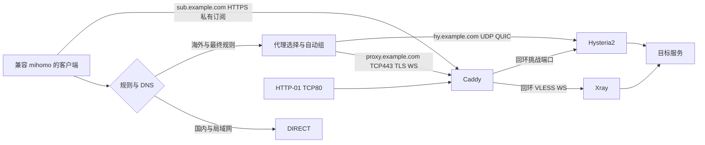

# 项目最终架构

项目围绕已有 Xray/Caddy 安装，提供 Hysteria2 共存、统一 mihomo 订阅、事务维护和 Docker Compose 运行。以下为源码实现的结构与接口，域名均使用可替换示例，不记录具体服务器的部署现场信息。

## 组件与数据流

两个代理节点默认按域名解析并连接，分别保留 TLS 身份；渲染器仅在显式提供可选 `SERVER_IP` 时使用连接覆盖。主域可提供独立 HTTPS 404，不公开节点及私有订阅路由。两个协议共享服务器和出口，因此不隔离整机、出口或共同网络故障。

## 模块职责

| 组成 | 职责与接口 |
| --- | --- |
| `cohost/render.py` | 读取并校验输入，生成 Hysteria2、Caddy、完整 mihomo 和 systemd unit |
| `cohost/deploy.py` | staged/final 生命周期、事务快照、原子发布、规则维护及共用验证 |
| `cohost/containers/manage.py` | Compose 迁移、容器/镜像/状态检查、systemd 回退 |
| `cohost/containers/compose.yaml` | 三个服务的 host 网络、挂载、账号、重启策略和权限 |
| Xray | VLESS/WebSocket 回环入口，由 Caddy 终止外部 TLS |
| Caddy | HTTPS/WebSocket、私有订阅及 Hysteria2 HTTP-01 挑战转发 |
| Hysteria2 | 独立认证、证书和 QUIC 数据通路 |
| `verify.py` | 服务端 TCP/UDP、正确及错误认证验证 |
| `verify_client.py`、`measure.py` | 隔离客户端分流、出口、下载、故障切换验证和按需测量 |
| GitHub Actions | 虚构输入的回归及固定版本 mihomo 校验，不执行生产部署 |

## 配置与状态

输入分为已有 Xray 私有状态和 Hysteria2/订阅参数；模板只保存非秘密字段与空凭据。首次安装生成缺省认证，后续维护复用，已有配置不一致则拒绝隐式轮换。域名、节点名称、路由 token 和文件名经过格式及冲突校验。

systemd 模式以 staged/final 表达迁移阶段，pending 标记指向受控回退快照；Compose 模式另保存迁移阶段、完整镜像 ID、受保护文件摘要及原 systemd 自启状态。维护共用互斥锁，先备份和验证候选，再原子发布并检查，异常时恢复。私有状态和诊断按受限权限保存，不进入项目发布。

具体字段、标准路径与命令见 [维护 README](cohost/README.md)。这些标准路径属于程序契约，不绑定个人账号、主机或带日期的部署目录。

## 容器与证书

原静态二进制和系统 CA 封装为 scratch 镜像，按完整本地镜像 ID 固定，不含配置或秘密。host 网络保留已有端口；配置目录只读挂载，证书/ACME 目录持久可写，根文件系统只读并限制能力和日志。

Caddy/Hysteria2 不使用容器强启动依赖。有效证书下 Hysteria2 的数据通路独立，但首次签发和续期仍需要 Caddy 的 HTTP-01 转发。回退 systemd 时保留现用证书，并恢复原 Caddy 账号对容器续期文件的所有权。迁移和失败恢复边界见 [容器 README](cohost/containers/README.md)。

## DNS、分流与客户端

入口域名和局域网直连；Google 服务与下载域名的代理/DNS 例外先于国内规则，随后匹配国内、海外、GeoIP CN 和最终代理规则。国内 DoH 直连，海外与 Google DoH 经代理，fake-IP 保留域名语义。

自动组默认每 60 秒探测、4 秒超时、50ms 容差，并要求响应码 204。Hysteria2 显式 DIRECT 拨号，代理选择组不提供 DIRECT；已建立长连接不因组切换自动迁移。

客户端 VPN 接管、应用绕过、独立 DNS、IPv6 和 MTU 会影响实际行为。手机商店和换网体验不能仅凭桌面隔离测试推断。

## 实现范围与后续边界

已实现的工具覆盖已有环境的配置与事务维护、双协议分流、隔离验证及容器迁移/回退。通用空白机安装、自动升级、持续监控、多 VPS 容灾未实现；重启、跨机还原、移动端与长期线路稳定性需要按目标环境验证。

仓库只发布项目本体、README、阶段设计和本架构说明。实施阶段与检查标准见 [阶段步骤实现](阶段步骤实现.md)，现场记录、审核报告、原始日志及秘密由使用者私下维护。
