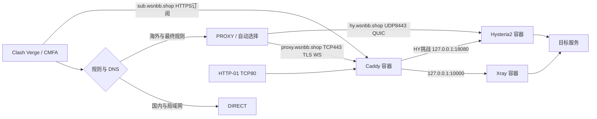

# 项目最终架构

更新：2026-10-25。当前为 Ubuntu24.04 单 VPS `35.73.46.1` 上的 Docker Compose 双协议代理；正式源码 `/home/ubuntu/cohost-proxy-20261020/`。三项原 systemd 单元 inactive/disabled，Docker enabled，容器 unless-stopped。

## 组件和数据流

两节点均显式连接 SERVER_IP，保留各自域名的 TLS 身份和验证。主域 wsnbb.shop 有独立 HTTPS404，不暴露订阅。三子域名仅 DNS，主域可使用当前 Cloudflare HTTP 代理。协议冗余不隔离整机、同出口或共同网络故障。

| 组成 | 职责与接口 |
| --- | --- |
| `cohost/render.py` | 根据私有状态生成 HY、Caddy、完整 mihomo 和回退 unit；无原域名专用解析 |
| `cohost/containers/manage.py` | Compose 迁移、镜像/服务/状态漂移与业务检查、systemd 回退 |
| `cohost/deploy.py` | 原 systemd 事务和共用快照、原子写入、验证；容器模式只开放 show |
| Xray 26.3.27 | 回环 VLESS/WS 10000，认证和代理数据路径 |
| Caddy 2.11.7 | TLS/WS、订阅、HY HTTP-01，保留既有其他应用转发 |
| Hysteria2 2.13.0 | UDP8443，独立证书、密码及 QUIC 数据路径 |
| `verify.py` / `verify_client.py` | 服务端 TCP/UDP/错误认证；外部 DNS、分流、协议出口、下载与故障切换 |
| GitHub Actions | 虚构配置测试与固定 mihomo 校验；不接触生产秘密或自动部署 |

## 容器和证书

原静态二进制与 CA 封装为 scratch 镜像，按完整本地镜像 ID 固定，不含配置或秘密。host 网络保留原端口；配置目录只读挂载以适配原子替换，证书/ACME 目录持久可写。根文件系统只读、no-new-privileges、日志限额。Xray/HY 使用原数字 UID/GID，Caddy root 仅保留低端口与读取原证书所需能力，具体见容器文档。

Caddy/HY 无容器启动强依赖。有效证书时 HY 数据路径独立，首次签发/续期仍依赖 TCP80 经 Caddy 转发至回环18080。新域名已经实际签发和检查，不能因证书目录存在就删续期转发。旧证书保留为私有恢复资料，不再生成原域名路由。

## DNS、分流和客户端边界

入口 IP/域名和局域网直连；Google 服务/下载域名与 DNS 例外优先于 .cn/GeoSite CN，之后为国内、海外、GeoIP CN 和最终 PROXY。国内 DoH 直连，海外/Google DoH 经 PROXY；fake-IP 保持域名语义，自动组60秒、4秒超时、50ms容差、要求204。已建立长连接不因组切换自动迁移。

Android 的 VPN 应用绕过、访问控制、私人 DNS、IPv6 和 MTU 属于客户端边界。桌面完整下载不能证明手机商店真实安装；本轮手机 Wi-Fi/移动数据仍需用户验收。

## 状态、恢复和限制

私有状态含认证和摘要，Caddy token 片段 root:caddy0640；Docker 检查补齐 Xray 状态摘要和片段权限检测。命令超时的诊断写入 root 私有文件，避免 stdout/stderr 类型差异导致诊断丢失。变更先备份、验证候选、原子发布，再检查和结束事务；本轮只重启 Caddy/HY。

当前内核 cubic、UDP 上限4MiB，未新增网络调优。没有持续监控、独立机器还原、整机重启演练、通用空白机安装器或多 VPS 容灾。现用路径及备份见 [部署目录](001部署文件目录.md)，实际验收见 [阶段步骤](阶段步骤实现.md)。
